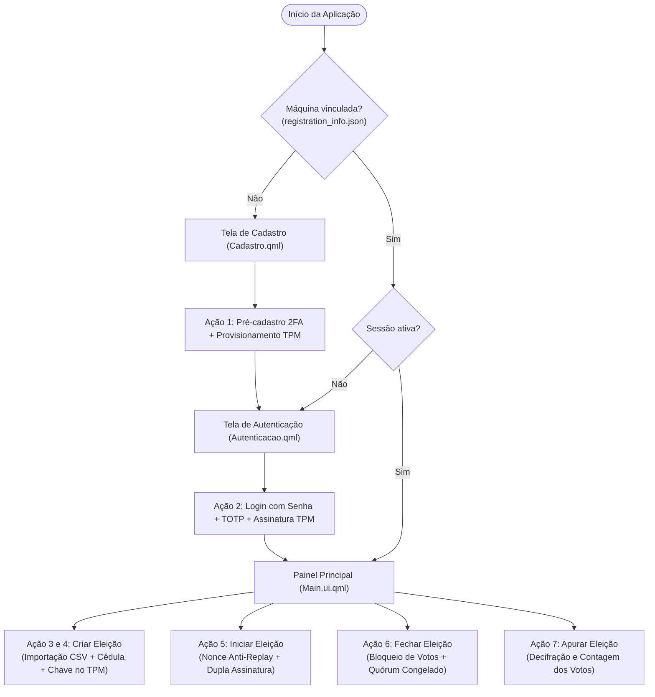
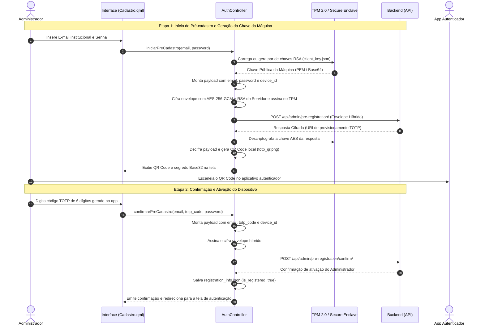
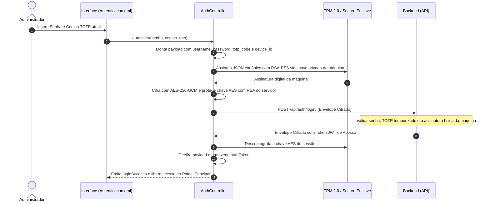
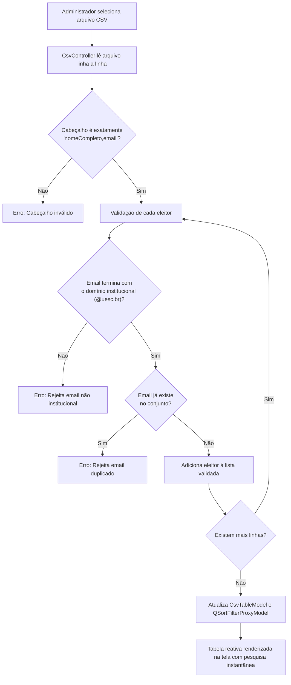
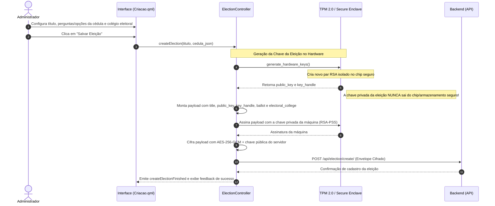
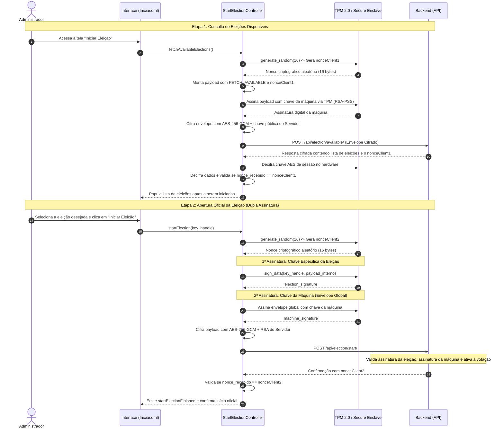
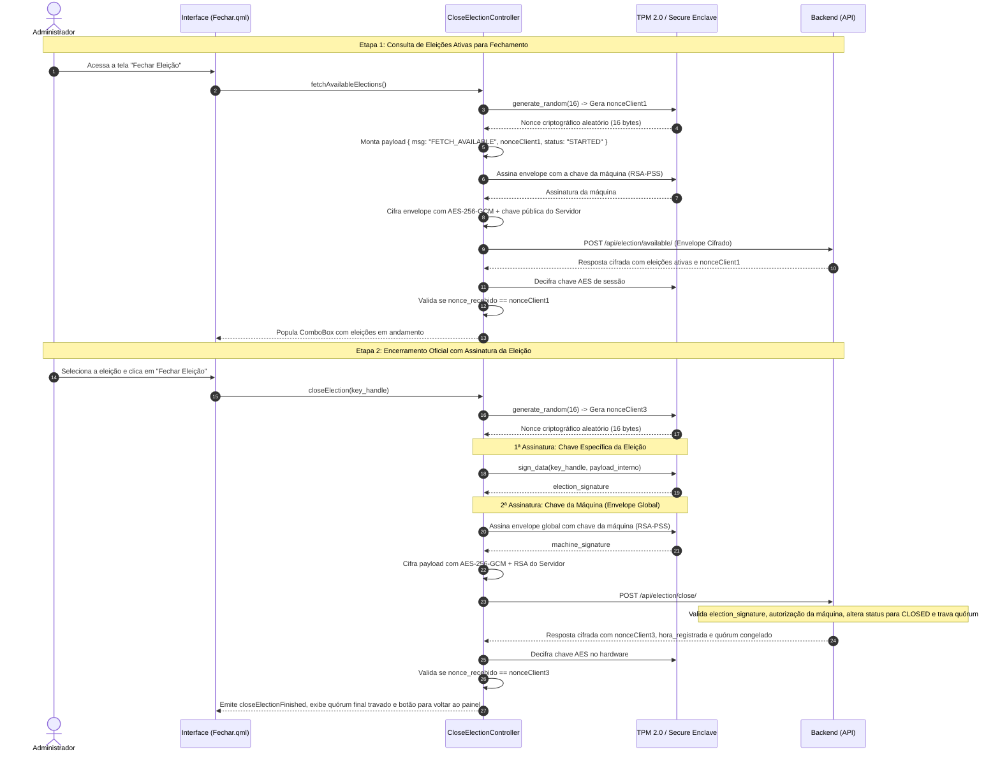
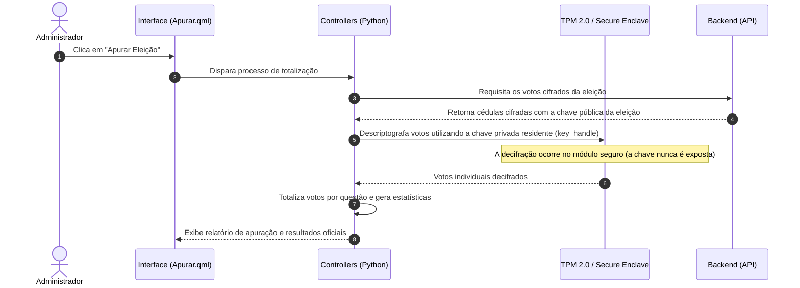
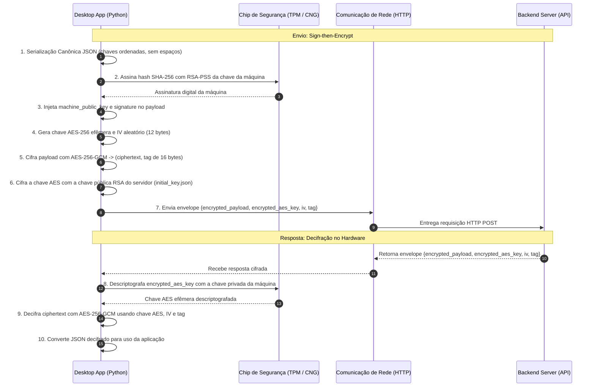

# VotaAí - Desktop Application

Aplicativo desktop do sistema de votação digital seguro **VotaAí**, desenvolvido em **Python 3.12+**, **PySide6 (Qt Quick / QML)** e integração com criptografia em hardware (**TPM 2.0 / CNG / Secure Storage**).

---

## 🚀 Requisitos e Configuração

### 1. Criar e Ativar o Ambiente Virtual
```bash
python -m venv .venv
source .venv/bin/activate  # No Linux / macOS
# .venv\Scripts\activate   # No Windows
```

### 2. Instalar Dependências
```bash
pip install -r requirements.txt
```

### 3. Variáveis de Ambiente (`.env`)
Crie um arquivo `.env` na raiz do projeto com base no [`.env.example`](.env.example):
```ini
INSTITUTIONAL_DOMAIN=@uesc.br
API_BASE_URL=http://127.0.0.1:8000
```

---

## 🔑 Configuração Obrigatória da Chave Inicial do Servidor (`initial_key.json`)

Para que o aplicativo Desktop consiga estabelecer a comunicação inicial criptografada com o backend (criptografia híbrida **AES-256-GCM + RSA**), é **obrigatório** fornecer a chave pública inicial do servidor no arquivo:

📁 `app/resources/initial_key.json`

### 📄 Modelo do `initial_key.json`

```json
{
    "KeyName": "VotaAI_SecureKey_1",
    "PublicKeyBase64": "==chave publica do servidor em base64==",
    "Algorithm": "RSA",
    "Provider": "Microsoft Platform Crypto Provider"
}
```

> **Nota:** Também é suportado o formato de lista de chaves exportado pelo comando `python manage.py generate_se_keys` do backend.

### 📌 Campos do Arquivo:
- **`KeyName`**: Identificador da chave no servidor (padrão: `"VotaAI_SecureKey_1"`).
- **`PublicKeyBase64`**: Chave pública do servidor em formato Base64 (BLOB CNG, DER ou PEM).
- **`Algorithm`**: Algoritmo criptográfico assimétrico utilizado (`"RSA"`).
- **`Provider`**: Nome do provedor criptográfico de origem.

Um arquivo de exemplo também está disponível em [`app/resources/initial_key.json.example`](app/resources/initial_key.json.example).

---

## 🖥️ Como Executar a Aplicação

Com o ambiente virtual ativo e o `initial_key.json` configurado:

```bash
python main.py
```

---

## 🔒 Arquitetura de Segurança Multiplataforma

- **Windows:** Integração com TPM nativo via [cng_windows.py](app/controllers/native/cng_windows.py) (**Windows CNG / `ncrypt.dll`**).
- **Linux / macOS:** Provedor seguro via [tpm_linux.py](app/controllers/native/tpm_linux.py) e [enclave_mac.py](app/controllers/native/enclave_mac.py) com chaves protegidas e permissões estritas de arquivo (`0600`).
- **Comunicação Segura:** Todos os payloads trafegam em envelopes cifrados com **AES-GCM**, onde a chave AES é protegida pela chave pública RSA do servidor e assinada com a chave privada residente no dispositivo.

> 💡 **Detalhamento Criptográfico:** Para a análise aprofundada de cada fase, algoritmos matemáticos, tamanhos de chaves e tabela de primitivas, veja a seção [Especificação Detalhada de Todas as Etapas de Criptografia (Desktop)](#-especificação-detalhada-de-todas-as-etapas-de-criptografia-desktop).

---

## 📊 Diagramas de Fluxo das Ações do Aplicativo Desktop

Esta seção documenta detalhadamente todos os fluxos e ações desempenhados pelo aplicativo Desktop no ciclo eleitoral, bem como a camada de segurança criptográfica em hardware.

---

### 1. Visão Geral da Navegação e Estados da Aplicação

O ciclo de vida do aplicativo varia conforme a existência de registro prévio e o estado da sessão do administrador:



---

### 2. Ação 1: Pré-cadastro do Administrador e Vinculação da Máquina (TPM + TOTP)

Fluxo executado quando o dispositivo ainda não possui um administrador associado. Realiza o provisionamento do par de chaves RSA em hardware e configuração do segundo fator (TOTP):



---

### 3. Ação 2: Autenticação em Dois Fatores (2FA) e Assinatura por Hardware

Login obrigatório para acesso às funções administrativas do sistema. A requisição é autenticada por senha, código TOTP de tempo limitado e a assinatura criptográfica da chave privada residente no chip seguro:



---

### 4. Ação 3: Importação e Validação do Colégio Eleitoral (CSV)

Processamento local dos arquivos CSV contendo os eleitores aptos a votar:



---

### 5. Ação 4: Criação e Registro de Nova Eleição com Chave Dedicada

Geração isolada da chave criptográfica da eleição diretamente no hardware e envio seguro da cédula e colégio eleitoral para a API:



---

### 6. Ação 5: Consulta e Abertura Oficial da Eleição (Anti-Replay e Dupla Assinatura)

Fluxo de abertura oficial da eleição com proteção contra ataques de repetição (*replay attack*) usando números aleatórios gerados no hardware (*hardware nonces*) e dupla assinatura digital:



---

### 7. Ação 6: Encerramento Oficial da Eleição e Congelamento de Quórum (`CloseElectionController`)

Fluxo de encerramento oficial da eleição com proteção anti-replay, validação da assinatura da chave da eleição via TPM e congelamento definitivo do quórum de votantes:



---

### 8. Ação 7: Apuração dos Resultados da Eleição (`Apurar.qml`)

Ação de decifração soberana e contagem dos votos em hardware:



---

### 9. Protocolo Criptográfico de Envelope Híbrido (Sign-then-Encrypt)

Padrão de comunicação utilizado em **todas** as interações entre o aplicativo Desktop e o Servidor Backend:



---

## 🔐 Especificação Detalhada de Todas as Etapas de Criptografia (Desktop)

O aplicativo **VotaAí Desktop** adota o princípio de segurança em profundidade (*defense-in-depth*), combinando criptografia assimétrica de hardware, envelopes híbridos autenticados e isolamento estrito de chaves privadas em todas as fases do ciclo de vida eleitoral. A seguir, detalham-se **todas as etapas criptográficas** executadas no cliente desktop:

---

### Etapa 1: Provisionamento e Isolamento da Chave de Hardware da Máquina (`Client Machine Key`)

Antes de qualquer comunicação com o servidor, o aplicativo provisiona um par de chaves assimétricas exclusivo para a estação de trabalho administrativa:

1. **Geração do Par de Chaves RSA (2048 bits):**
   - **No Windows:** Utiliza a API nativa **Windows CNG (Cryptography Next Generation)** através de `ncrypt.dll`. O aplicativo solicita a criação de uma chave persistente com algoritmo `BCRYPT_RSA_ALGORITHM` e tamanho de 2048 bits via provedor `MS_PLATFORM_CRYPTO_PROVIDER` (TPM 2.0). Se o chip físico não estiver disponível, recorre ao `MS_KEY_STORAGE_PROVIDER`.
   - **No Linux:** Invoca a suíte de comandos `tpm2-tools`:
     - Cria uma chave primária na hierarquia de proprietário (`tpm2_createprimary -C o -G rsa -g sha256`).
     - Cria a chave filha RSA (`tpm2_create -G rsa -g sha256`).
     - Carrega a chave no módulo TPM (`tpm2_load`).
     - Persiste a chave no handle reservado `0x81010010` (`tpm2_evictcontrol`).
     - **Confinamento Absoluto:** A chave privada reside exclusivamente dentro do silício do TPM e **nunca** é exportada para a memória RAM do sistema operacional ou disco.
   - **Fallback Seguro em Software (Linux sem TPM):**
     - Caso o chip TPM físico não esteja acessível, o sistema gera uma chave privada RSA 2048 bits e calcula uma chave simétrica de proteção de 256 bits através de **PBKDF2-HMAC-SHA256** com **200.000 iterações**, vinculada deterministicamente ao identificador único do equipamento (`/etc/machine-id` ou hostname) e salt de domínio fixo.
     - A chave privada é cifrada em repouso com **AES-256-GCM** (salva em `app/resources/.client_keys/`) com permissões estritas de sistema de arquivos (`chmod 0600`).
2. **Exportação e Metadados Públicos:**
   - Apenas os metadados e a chave pública (em formatos **BCRYPT_RSAKEY_BLOB**, **DER** ou **PEM**) são gravados em `app/resources/client_key.json`.
   - Essa chave pública (`machine_public_key`) passa a ser a identidade criptográfica oficial desta máquina perante a autoridade eleitoral.

---

### Etapa 2: Pré-cadastro e Confirmação de Administrador (2FA TOTP + Assinatura de Hardware)

Vincula o primeiro administrador ao equipamento físico de forma criptograficamente auditável:

1. **Início do Pré-cadastro (`iniciarPreCadastro`):**
   - O administrador insere seu e-mail institucional (`@uesc.br`) e senha mestra.
   - O payload contendo `{ email, password, device_id }` é assinado com a chave da máquina e cifrado via envelope híbrido para a chave pública do servidor (`VotaAI_SecureKey_1`).
   - Requisição enviada via `POST /api/admin/pre-registration/`.
2. **Decifração e Provisionamento do Segundo Fator (TOTP):**
   - O backend gera uma chave secreta TOTP e retorna a URI oficial de provisionamento (`otpauth://totp/VotaAi:...`).
   - A resposta vem cifrada com a chave pública da máquina; o cliente desktop aciona o hardware TPM para decifrar a chave de sessão AES e decodificar o payload.
   - O desktop gera localmente a imagem do QR Code (`totp_qr.png`) e extrai o segredo Base32 para configuração no aplicativo autenticador (Google Authenticator, Microsoft Authenticator, etc.).
3. **Confirmação e Ativação do Dispositivo (`confirmarPreCadastro`):**
   - O administrador insere o código numérico de 6 dígitos gerado no autenticador.
   - O desktop empacota `{ email, totp_code, device_id }`, assina digitalmente no TPM e envia via `POST /api/admin/pre-registration/confirm/`.
   - Após validação no backend, salva o registro definitivo em `app/resources/registration_info.json`.

---

### Etapa 3: Autenticação de Sessão (Login Multi-Fator com Assinatura em Silício)

O acesso às funcionalidades do painel administrativo exige a combinação de múltiplos fatores físicos e lógicos:

1. **Montagem do Payload de Autenticação:**
   - Reúne `{ username, password, totp_code, device_id, machine_public_key }`.
2. **Assinatura Digital Física via Hardware (RSA-PSS):**
   - O JSON canônico é submetido ao TPM/CNG.
   - A chave privada residente assina o hash SHA-256 do payload canônico utilizando **RSA-PSS** (*Probabilistic Signature Scheme*) com salt de comprimento máximo (`salt_length=MAX_LENGTH`).
3. **Cifragem de Envio:**
   - O envelope completo é cifrado com AES-256-GCM efêmero e protegido pela chave pública do servidor.
   - Requisição enviada para `POST /api/auth/login/`.
4. **Recepção e Decifração do Token JWT de Sessão:**
   - O servidor valida a senha, o código TOTP sincronizado por tempo e a assinatura digital da máquina.
   - O backend emite um token de acesso JWT (Knox Token), cifrando a resposta com a chave pública da máquina (`machine_public_key`).
   - O desktop submete a chave AES cifrada ao hardware TPM para decifração e armazena o token de sessão autenticado na memória.

---

### Etapa 4: Criação de Eleição e Geração de Chave Dedicada da Eleição (`Election Key`)

Para garantir que a urna eletrônica seja totalmente cega e que nem mesmo o servidor backend consiga decifrar votos antes da apuração, cada eleição possui sua própria chave criptográfica isolada:

1. **Geração de Chave Dedicada da Eleição no Hardware (`generate_hardware_keys`):**
   - O controlador aciona o módulo de segurança para gerar um novo par RSA 2048 bits isolado.
   - **No Linux TPM:** Aloca um handle persistente específico para a eleição.
   - **No Windows CNG:** Cria um contêiner exclusivo de chave sob o provedor de plataforma.
   - **Segredo Confinado:** A chave privada da eleição **permanece permanentemente no hardware seguro** do desktop do administrador e jamais é transmitida pela rede.
2. **Construção e Cifragem da Cédula Oficial:**
   - Monta-se o payload contendo o título, as perguntas/opções, a lista do colégio eleitoral validada pelo CSV, a **chave pública da eleição** gerada e o identificador do handle (`key_handle`).
   - O payload é assinado com a chave da máquina e cifrado com AES-256-GCM + chave do servidor.
   - Requisição enviada para `POST /api/election/create/`.
   - A partir deste momento, todos os votos que os eleitores depositarem no aplicativo mobile serão cifrados com esta chave pública da eleição.

---

### Etapa 5: Consulta e Abertura Oficial com Proteção Anti-Replay e Dupla Assinatura Digital

A abertura de uma eleição altera o estado da urna para aceitar votos e requer garantias criptográficas adicionais contra ataques de repetição (*replay attacks*):

1. **Consulta Segura de Eleições (`fetchAvailableElections`):**
   - O desktop solicita ao hardware a geração de 16 bytes de alta entropia via RNG do TPM (`generate_random(16)`), obtendo `nonceClient1`.
   - Envia `{ msg: "FETCH_AVAILABLE", nonceClient1 }` assinado e cifrado para `POST /api/election/available/`.
   - O backend processa e inclui o mesmo `nonceClient1` na resposta cifrada.
   - O desktop decifra a resposta e valida rigorosamente se `nonce_recebido == nonceClient1`. Se divergente, aborta a operação imediatamente.
2. **Abertura Oficial com Dupla Assinatura Digital (`startElection`):**
   - Gera um novo nonce de alta entropia no hardware (`nonceClient2`).
   - Monta o payload `{ msg: "START_ELECTION", keyHandle: key_handle, nonceClient2 }`.
   - **1ª Assinatura Digital (Chave da Eleição):**
     - O JSON canônico deste payload interno é assinado especificamente com a chave privada da eleição residente no hardware (`crypto_controller.sign_data(key_handle, payload_str)`), gerando `election_signature`.
     - Isso comprova matematicamente ao servidor que quem está iniciando a eleição detém a posse física da chave privada daquela eleição.
   - **2ª Assinatura Digital (Chave da Máquina):**
     - O payload resultante com `election_signature` é então encapsulado pelo `EncryptionController`, que assina o envelope global com a chave da máquina (`signature`).
   - O pacote é cifrado com AES-256-GCM e enviado para `POST /api/election/start/`.
   - O backend valida a assinatura da eleição, a assinatura da máquina, o token de sessão do administrador e o nonce, ativando formalmente o pleito.

---

### Etapa 6: Protocolo de Envelope Híbrido Sign-then-Encrypt (Comunicação em Todas as Requisições)

Todas as requisições enviadas e recebidas pelo desktop seguem rigorosamente o padrão **Sign-then-Encrypt**:

#### 📤 Fluxo de Cifragem de Saída (Desktop ➔ Backend):
1. **Higienização:** Remove qualquer campo `signature` preexistente do dicionário.
2. **Injeção de Identidade:** Adiciona o campo `machine_public_key` com a chave pública RSA em formato PEM.
3. **Serialização Canônica JSON (RFC 8785):**
   $$\text{canonical\_json} = \text{dumps}(payload, \text{sort\_keys}=\text{True}, \text{separators}=(',', ':'), \text{ensure\_ascii}=\text{False})$$
4. **Assinatura Digital de Hardware:**
   $$\text{signature\_bytes} = \text{HardwareSign}_{\text{priv\_machine}}(\text{SHA-256}(\text{canonical\_json}))$$
   - Aplica esquema **RSA-PSS** com MGF1-SHA256 e salt máximo.
   - Converte para Base64 e injeta no payload: `payload["signature"] = signature_b64`.
5. **Geração de Segredo de Sessão:**
   - Gera uma chave simétrica efêmera de 256 bits (32 bytes): $K_{\text{AES}} \leftarrow \text{CSPRNG}(32)$.
   - Gera um Vetor de Inicialização (IV) de 96 bits (12 bytes): $\text{IV} \leftarrow \text{CSPRNG}(12)$.
6. **Cifragem Autenticada com AES-256-GCM:**
   $$(\text{ciphertext}, \text{tag}) = \text{AES-GCM-Encrypt}(K_{\text{AES}}, \text{IV}, \text{signed\_json\_bytes})$$
   - A Tag de autenticação possui 128 bits (16 bytes) e garante a integridade e autenticidade de todo o texto cifrado.
7. **Proteção Assimétrica da Chave de Sessão:**
   $$\text{encrypted\_aes\_key} = \text{RSA-Encrypt}_{\text{pub\_server}}(K_{\text{AES}}, \text{padding}=\text{PKCS1v15})$$
   - Utiliza a chave pública oficial do servidor obtida em `app/resources/initial_key.json` (`VotaAI_SecureKey_1`).
8. **Transmissão do Envelope Quádruplo:**
   - Os 4 componentes são codificados em Base64 e transmitidos no corpo HTTP JSON:
   ```json
   {
       "encrypted_payload": "<Base64 do ciphertext>",
       "encrypted_aes_key": "<Base64 da chave AES cifrada com RSA>",
       "iv": "<Base64 do vetor de inicialização de 12 bytes>",
       "tag": "<Base64 da tag de autenticação GCM de 16 bytes>"
   }
   ```

#### 📥 Fluxo de Decifração de Entrada (Backend ➔ Desktop):
1. O backend responde com o mesmo formato de envelope quádruplo, tendo cifrado a chave AES de retorno com a `machine_public_key` do desktop.
2. O desktop extrai `encrypted_aes_key` e envia para o hardware TPM/CNG decifrar com a chave privada residente da máquina (`crypto_backend.decrypt_data`).
3. O hardware devolve a chave simétrica efêmera $K_{\text{AES}}$ descriptografada na memória volátil.
4. O desktop instancia `AESGCM(aes_key)` e decifra `(ciphertext + tag)` usando o `iv`.
5. Se a tag for válida, o JSON plano é decodificado e repassado para a interface; caso contrário, é lançada uma exceção de adulteração de dados.

---

### Etapa 7: Encerramento da Eleição e Congelamento de Quórum (`CloseElectionController`)

O encerramento oficial encerra a recepção de votos, congela as métricas do quórum e prepara a eleição para a apuração:

1. **Consulta Filtrada de Eleições em Andamento (`fetchAvailableElections`):**
   - O desktop gera um nonce aleatório de alta entropia (`nonceClient1`) via RNG de hardware do TPM (`generate_random(16)`).
   - Envia `{ msg: "FETCH_AVAILABLE", nonceClient1, status: "STARTED" }` assinado e cifrado via envelope híbrido para `POST /api/election/available/`.
   - O backend filtra apenas as eleições com status `STARTED` criadas pela máquina conectada.
   - O desktop valida o eco de `nonceClient1` e popula a interface reativa de seleção (`Fechar.qml`).
2. **Ordem de Fechamento com Assinatura da Eleição (`closeElection`):**
   - Gera um novo nonce anti-replay (`nonceClient3`).
   - Monta o payload canônico `{ msg: "CLOSE_ELECTION", keyHandle: key_handle, nonceClient3 }`.
   - **Assinatura da Eleição (Hardware):** Invoca `crypto_controller.sign_data(key_handle, payload_str)`, comprovando a autoridade sobre a chave daquela eleição.
   - **Assinatura da Máquina (Envelope):** O `HttpClient` assina o envelope global com a chave da máquina e cifra para a chave pública do servidor (`VotaAI_SecureKey_1`).
   - Enviado para `POST /api/election/close/`.
   - O backend valida as duas assinaturas, muda o status para `CLOSED`, registra o timestamp de término (`end_datetime`) e trava o número de votantes e votos depositados.
   - O desktop decifra a resposta, confere o `nonceClient3` e exibe na interface o quórum definitivo congelado com botão de retorno ao painel.

---

### Etapa 8: Apuração dos Votos por Hardware (`Tallying`)

Ao término da votação e com o quórum devidamente congelado, realiza-se o processo soberano de decifração e contagem:

1. **Download das Cédulas Cifradas (`Apurar.qml`):**
   - O aplicativo desktop requisita todos os votos registrados no banco de dados da urna.
   - Cada voto registrado no servidor está cifrado com a chave pública da eleição gerada na Etapa 4.
2. **Decifração em Hardware e Contagem Local:**
   - Para cada cédula cifrada recebida, o desktop aciona o hardware de segurança passando o identificador da eleição:
     $$\text{voto\_plano} = \text{HardwareDecrypt}(key\_handle, \text{voto\_cifrado})$$
   - A decifração ocorre estritamente dentro do enclave/chip seguro. A chave privada da eleição **jamais é revelada**.
   - O controlador Python contabiliza as respostas, computa os totais e gera o relatório oficial de apuração com hashes de integridade.

---

### 📋 Tabela Resumo das Primitivas e Parâmetros Criptográficos (Desktop)

| Finalidade | Algoritmo / Primitiva | Tamanho de Chave / Bloco | Padding / Esquema | Provedor / Implementação |
| :--- | :--- | :--- | :--- | :--- |
| **Identidade da Máquina** | RSA | 2048 bits ($e=65537$) | PKCS#1 v1.5 / PSS | TPM 2.0 (`0x81010010`) / Windows CNG (`MS_PLATFORM_CRYPTO_PROVIDER`) |
| **Assinatura de Payloads** | RSA-PSS | 2048 bits | MGF1(SHA-256), Salt MAX | `tpm2_sign` / `NCryptSignHash` (Hardware Seguro) |
| **Chave da Eleição** | RSA | 2048 bits ($e=65537$) | PKCS#1 v1.5 / RSAES | TPM 2.0 / Windows CNG (Isolamento por Pleito) |
| **Cifragem de Sessão** | AES-GCM | 256 bits ($K_{\text{AES}}$) | NoPadding, Tag 128 bits | `cryptography.hazmat.primitives.ciphers.aead.AESGCM` |
| **Vetor de Inicialização (IV)** | Aleatório CSPRNG | 96 bits (12 bytes) | N/A | `os.urandom(12)` |
| **Cifragem da Chave AES** | RSA Assimétrico | 2048 bits (Chave Servidor 1) | PKCS#1 v1.5 | `padding.PKCS1v15()` / Chave `VotaAI_SecureKey_1` |
| **Proteção Anti-Replay** | Pseudoaleatório CSPRNG | 128 bits (16 bytes) | N/A | RNG de Hardware do TPM (`tpm2_getrandom` / `generate_random`) |
| **Fallback Software (Linux)** | PBKDF2-HMAC-SHA256 | 256 bits | 200.000 iterações | `machine-id` + AES-256-GCM em disco (`chmod 0600`) |
| **Segundo Fator (2FA)** | HMAC-SHA1 (TOTP) | 6 dígitos numéricos | Janela temporal de 30s | RFC 6238 / QR Code `otpauth://` |

---

## 📂 Estrutura de Pastas

A organização do repositório foi planejada para separar claramente a interface (UI) das regras de negócio (Python) e serviços de rede:

```text
votaai-desktop/
├── app/                  # Lógica de negócio e comunicação em Python
│   ├── controllers/      # Controladores que integram as telas (QML) com as ações do sistema (ex: AuthController, StartElectionController, CloseElectionController)
│   ├── services/         # Serviços puramente de API e rede (ex: HttpClient, ElectionApi)
│   └── resources/        # Arquivos locais e de chaves criptográficas (ex: initial_key.json)
├── Design/               # Interface de Usuário (UI)
│   └── DesignContent/    # Componentes visuais e telas desenvolvidos em Qt Quick / QML
├── mock_csvs/            # Arquivos CSV usados para testes locais
├── main.py               # Arquivo principal que inicia a aplicação PySide6
├── run_commands.py       # Script utilitário para facilitar comandos do Git/CLI do projeto
└── requirements.txt      # Arquivo de dependências do Python
```
