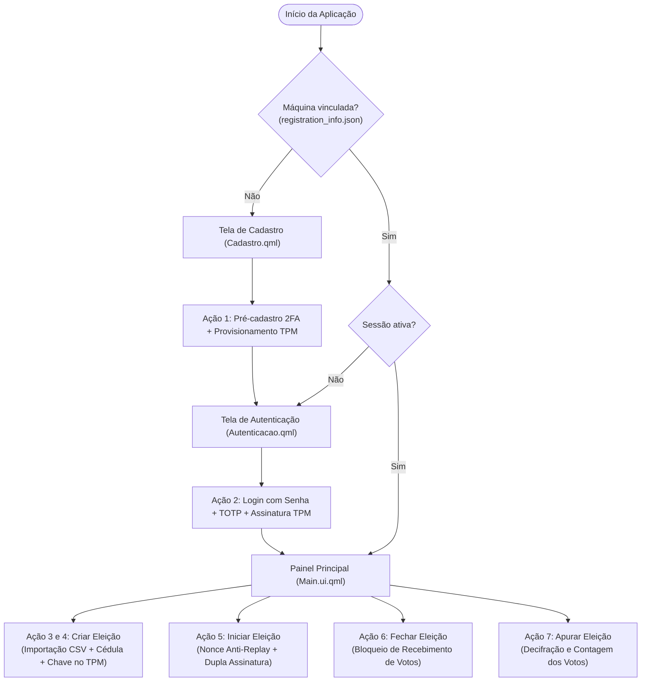
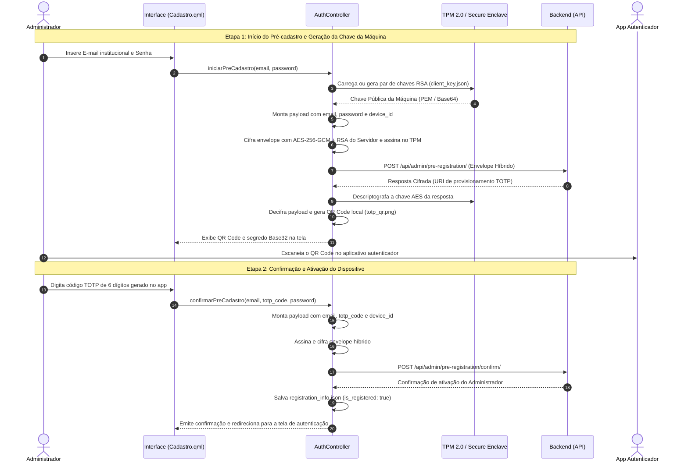
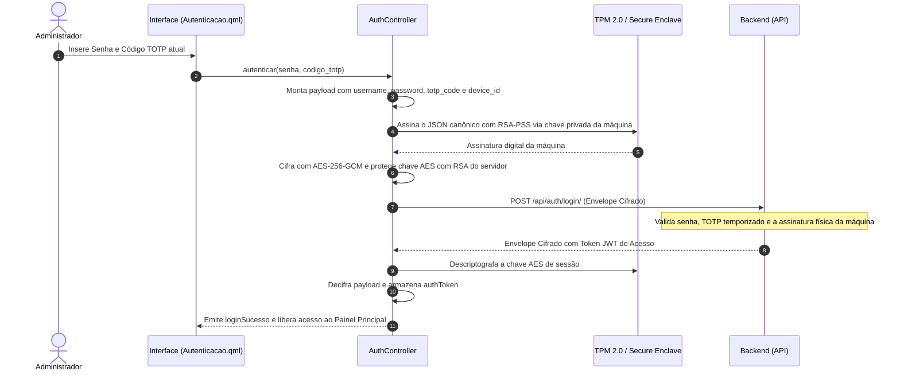
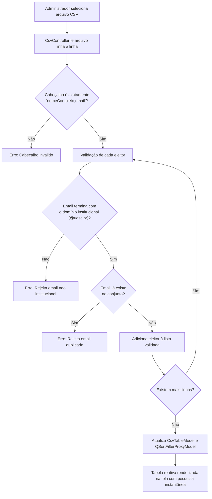
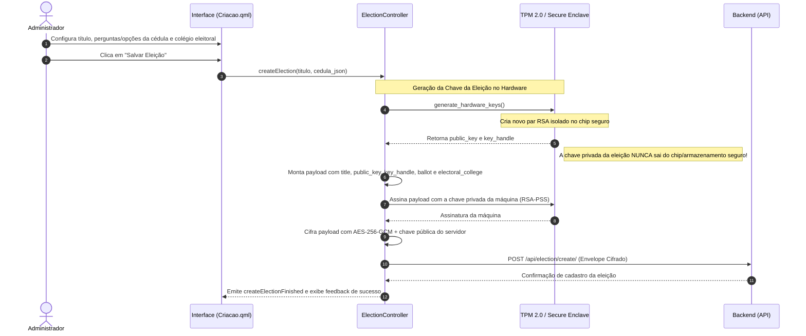
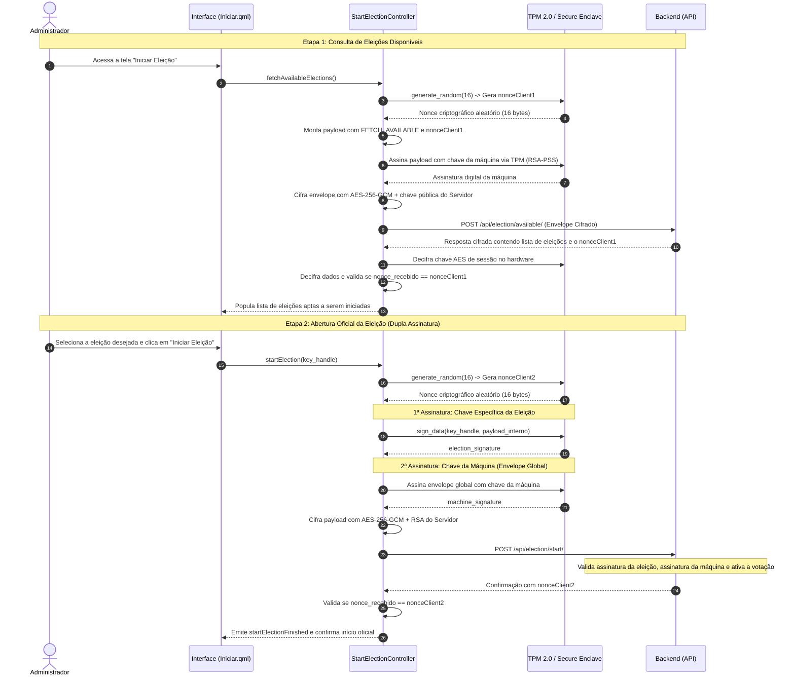
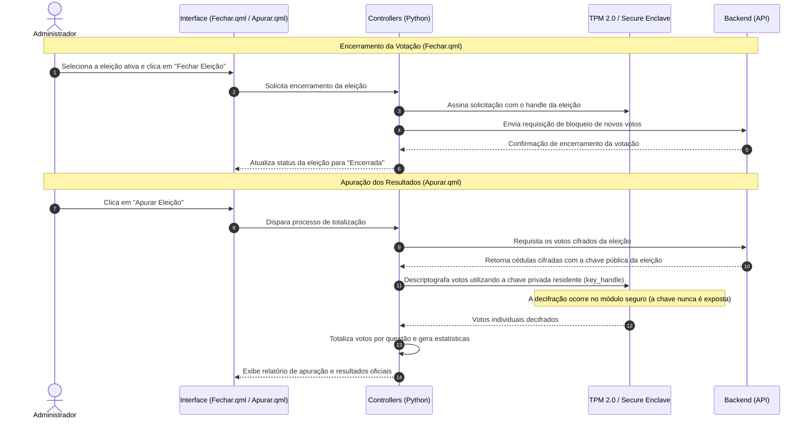
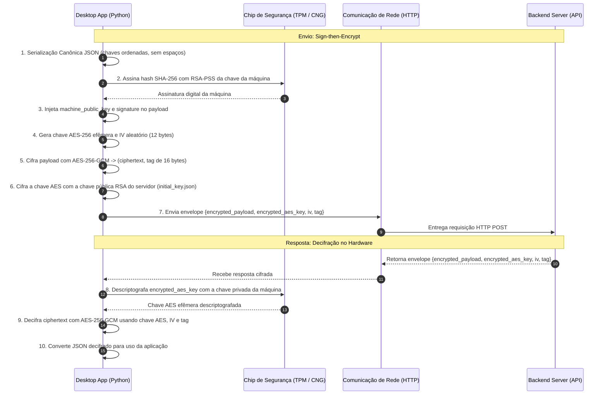

# VotaAí - Desktop Application

Aplicativo desktop do sistema de votação digital seguro **VotaAí**, desenvolvido em **Python 3.12+**, **PySide6 (Qt Quick / QML)** e integração com criptografia em hardware (**TPM 2.0 / CNG / Secure Storage**).

---

## 🚀 Requisitos e Configuração

### 1. Criar e Ativar o Ambiente Virtual
```bash
python -m venv .venv
source .venv/bin/activate  # No Linux / macOS
# .venv\Scripts\activate   # No Windows
```

### 2. Instalar Dependências
```bash
pip install -r requirements.txt
```

### 3. Variáveis de Ambiente (`.env`)
Crie um arquivo `.env` na raiz do projeto com base no [`.env.example`](.env.example):
```ini
INSTITUTIONAL_DOMAIN=@uesc.br
API_BASE_URL=http://127.0.0.1:8000
```

---

## 🔑 Configuração Obrigatória da Chave Inicial do Servidor (`initial_key.json`)

Para que o aplicativo Desktop consiga estabelecer a comunicação inicial criptografada com o backend (criptografia híbrida **AES-256-GCM + RSA**), é **obrigatório** fornecer a chave pública inicial do servidor no arquivo:

📁 `app/resources/initial_key.json`

### 📄 Modelo do `initial_key.json`

```json
{
    "KeyName": "VotaAI_SecureKey_1",
    "PublicKeyBase64": "==chave publica do servidor em base64==",
    "Algorithm": "RSA",
    "Provider": "Microsoft Platform Crypto Provider"
}
```

> **Nota:** Também é suportado o formato de lista de chaves exportado pelo comando `python manage.py generate_se_keys` do backend.

### 📌 Campos do Arquivo:
- **`KeyName`**: Identificador da chave no servidor (padrão: `"VotaAI_SecureKey_1"`).
- **`PublicKeyBase64`**: Chave pública do servidor em formato Base64 (BLOB CNG, DER ou PEM).
- **`Algorithm`**: Algoritmo criptográfico assimétrico utilizado (`"RSA"`).
- **`Provider`**: Nome do provedor criptográfico de origem.

Um arquivo de exemplo também está disponível em [`app/resources/initial_key.json.example`](app/resources/initial_key.json.example).

---

## 🖥️ Como Executar a Aplicação

Com o ambiente virtual ativo e o `initial_key.json` configurado:

```bash
python main.py
```

---

## 🔒 Arquitetura de Segurança Multiplataforma

- **Windows:** Integração com TPM nativo via [cng_windows.py](app/controllers/native/cng_windows.py) (**Windows CNG / `ncrypt.dll`**).
- **Linux / macOS:** Provedor seguro via [tpm_linux.py](app/controllers/native/tpm_linux.py) e [enclave_mac.py](app/controllers/native/enclave_mac.py) com chaves protegidas e permissões estritas de arquivo (`0600`).
- **Comunicação Segura:** Todos os payloads trafegam em envelopes cifrados com **AES-GCM**, onde a chave AES é protegida pela chave pública RSA do servidor e assinada com a chave privada residente no dispositivo.


---

## 📊 Diagramas de Fluxo das Ações do Aplicativo Desktop

Esta seção documenta detalhadamente todos os fluxos e ações desempenhados pelo aplicativo Desktop no ciclo eleitoral, bem como a camada de segurança criptográfica em hardware.

---

### 1. Visão Geral da Navegação e Estados da Aplicação

O ciclo de vida do aplicativo varia conforme a existência de registro prévio e o estado da sessão do administrador:



---

### 2. Ação 1: Pré-cadastro do Administrador e Vinculação da Máquina (TPM + TOTP)

Fluxo executado quando o dispositivo ainda não possui um administrador associado. Realiza o provisionamento do par de chaves RSA em hardware e configuração do segundo fator (TOTP):



---

### 3. Ação 2: Autenticação em Dois Fatores (2FA) e Assinatura por Hardware

Login obrigatório para acesso às funções administrativas do sistema. A requisição é autenticada por senha, código TOTP de tempo limitado e a assinatura criptográfica da chave privada residente no chip seguro:



---

### 4. Ação 3: Importação e Validação do Colégio Eleitoral (CSV)

Processamento local dos arquivos CSV contendo os eleitores aptos a votar:



---

### 5. Ação 4: Criação e Registro de Nova Eleição com Chave Dedicada

Geração isolada da chave criptográfica da eleição diretamente no hardware e envio seguro da cédula e colégio eleitoral para a API:



---

### 6. Ação 5: Consulta e Abertura Oficial da Eleição (Anti-Replay e Dupla Assinatura)

Fluxo de abertura oficial da eleição com proteção contra ataques de repetição (*replay attack*) usando números aleatórios gerados no hardware (*hardware nonces*) e dupla assinatura digital:



---

### 7. Ação 6: Encerramento e Apuração da Eleição

Ações finais de encerramento do recebimento de votos e contagem dos resultados:



---

### 8. Protocolo Criptográfico de Envelope Híbrido (Sign-then-Encrypt)

Padrão de comunicação utilizado em **todas** as interações entre o aplicativo Desktop e o Servidor Backend:




---

## 📂 Estrutura de Pastas

A organização do repositório foi planejada para separar claramente a interface (UI) das regras de negócio (Python) e serviços de rede:

```text
votaai-desktop/
├── app/                  # Lógica de negócio e comunicação em Python
│   ├── controllers/      # Controladores que integram as telas (QML) com as ações do sistema (ex: AuthController)
│   ├── services/         # Serviços puramente de API e rede (ex: HttpClient, ElectionApi)
│   └── resources/        # Arquivos locais e de chaves criptográficas (ex: initial_key.json)
├── Design/               # Interface de Usuário (UI)
│   └── DesignContent/    # Componentes visuais e telas desenvolvidos em Qt Quick / QML
├── mock_csvs/            # Arquivos CSV usados para testes locais
├── main.py               # Arquivo principal que inicia a aplicação PySide6
├── run_commands.py       # Script utilitário para facilitar comandos do Git/CLI do projeto
└── requirements.txt      # Arquivo de dependências do Python
```
